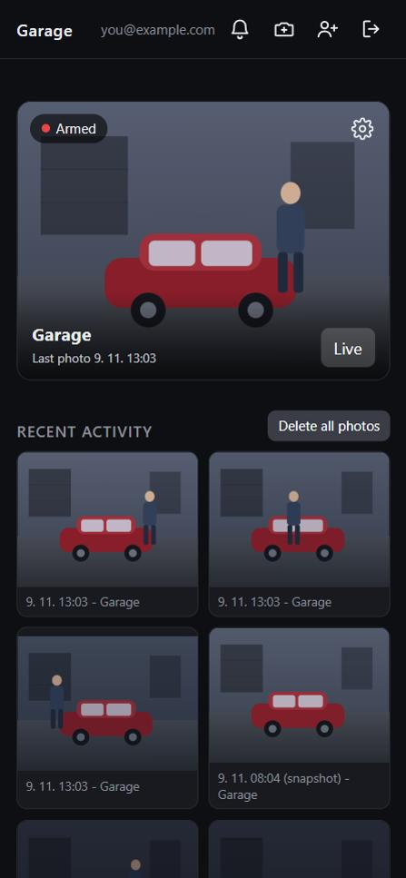
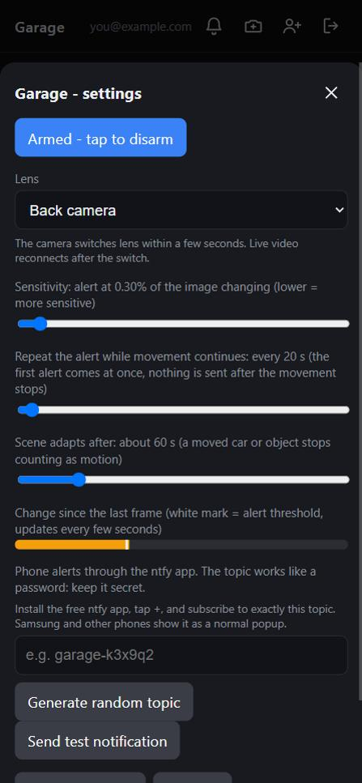
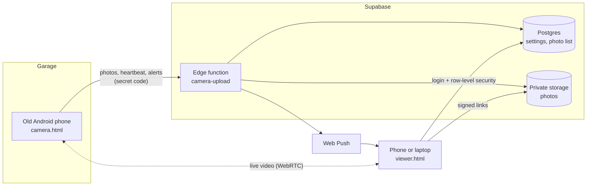

# Garage camera

**Turn an old Android phone into a private, motion-activated garage camera.**
It spots movement, takes photos instantly, shows live video, and sends an alert to your phone.
It runs entirely in the browser, keeps your photos behind a login, and costs nothing to run.

  
  &nbsp;&nbsp;
  

The viewer on a phone (drawn demo scenes, not real footage).

## Why

A spare phone already has a camera, a screen, a battery and Wi-Fi. This project turns it into a camera that:

- needs **no app install**: the garage phone just keeps a web page open,
- keeps everything **private**: nothing is visible without logging in, and the camera itself has no account,
- is **free to run**: GitHub Pages for the pages, the Supabase free tier for the storage and the server,
- is **controlled remotely**: all settings live on the viewer, the garage phone only films.

## Features

- **Motion detection that ignores noise.** It compares each picture with a slowly updating reference image, learns the camera's own noise level, and only reacts to real movement. A moved car or a left object is absorbed after a few seconds instead of triggering forever.
- **Instant photos.** At the first sign of movement the phone takes three photos (at 0, 0.5 and 1.2 seconds) and uploads them afterwards from a queue, so a slow connection never makes it miss the moment.
- **Alert episodes, no spam.** A rustle does nothing. Movement that adds up to about a second counts as confirmed: you get one alert at once, a repeat every 20 seconds while it continues, and nothing once it stops.
- **Live view.** Real video straight from the camera (WebRTC). If a direct link cannot be made, it falls back to a small picture every moment.
- **Everything is set on the viewer.** Arm and disarm, sensitivity, repeat interval, back or front (selfie) lens, "take a photo now", and a live bar showing how much of the picture is changing.
- **Photo history.** A grid of recent photos with delete and delete-all.
- **Several people, one camera.** Family members join with one-time invite codes. Cameras join with a short secret code.
- **Works on old phones.** Built to run on an Android 5.1 phone with a plain Chrome browser: no framework, no build step, no app to install.
- **Updates itself.** The camera page checks for a new version every minute and reloads, so you never have to touch the phone in the garage.

## How it works

1. The **camera page** analyses the picture on the phone itself, so no video leaves the garage unless you open the live view. When it sees confirmed movement it takes photos and sends them, together with a small heartbeat every 8 seconds.
2. The **edge function** checks the camera's secret code, stores the photo privately and sends the alert.
3. The **viewer page** (logged in) reads the settings, photos and status, and writes the settings back. The camera picks them up on its next heartbeat.

## Privacy and security

This repository is public on purpose, and that is safe: it contains **no secrets and no footage**.

- Photos live in a **private bucket**. The viewer gets short-lived signed links, only after login.
- Access is enforced by the database itself (**row-level security**), not by hiding the page. Visitors without a viewer role can read nothing.
- The **camera has no account**. It holds a 12-character secret code (about 72 bits of randomness). Only a hash is stored on the server, and the code can only upload; it can never read anything. Remove the camera in the viewer and its code stops working at once.
- New viewers need a **one-time invite code** from an existing viewer. Anyone can create a login, but without a code it can see nothing.
- The keys used to sign push notifications are created by the server and never leave it.

## Tech

| Part | Technology |
|---|---|
| Pages | Plain HTML and JavaScript (no build step), hosted on GitHub Pages |
| Motion detection | Canvas pixel analysis in the browser |
| Live video | WebRTC, signalled through the database |
| Backend | Supabase: Postgres with row-level security, private Storage, Edge Functions (Deno) |
| Alerts | Web Push (service worker, VAPID), optional ntfy topic |

## Files

| Path | What it is |
|---|---|
| `demo/camera.html` | The page the garage phone keeps open: camera, motion detection, uploads |
| `demo/viewer.html` | The page you watch on: camera card, live view, photos, settings, invites |
| `demo/sb.js`, `demo/auth.js`, `demo/config.js` | A tiny Supabase client (fetch only), the login box and the public project settings |
| `demo/sw.js` | Service worker that shows push notifications |
| `demo/version.json` | Version marker; the camera page reloads itself when it changes |

## Using it

1. Open the **viewer** page, create an account with an invite code, and log in.
2. Tap the camera icon in the header to **add a camera**. You get a short secret code, shown once.
3. On the garage phone open the **camera** page, enter the code, allow the camera, and leave the page open.
4. In the viewer, tap the gear on the camera card and **arm** it. Walk in front of the camera and watch the live bar to tune the sensitivity.
5. Tap the bell on each device that should get alerts, and use **Send test notification** to check it.

Tips for the garage phone: keep it plugged in, set the screen timeout to "never", and keep Chrome open on the camera page. A cheap smart plug that cuts charging at about 80% is kind to an old battery.

## Good to know

- **Notifications:** On Samsung phones web notifications appear in the notification shade and do not pop up over an open app. On an iPhone, add the viewer to the Home Screen first. An optional ntfy topic can be added in the camera settings, but ntfy's free tier has a daily message limit.
- **Live video** uses a free public STUN server and no relay, so on some networks it falls back to pictures.
- **Storage:** the free Supabase tier holds 1 GB. Photos are about 100 KB each, and a delete-all button is in the viewer.
- This is a hobby project, not a certified security product.

## Run your own

You need a free Supabase project and a GitHub account.

1. Create a Supabase project and set its URL and public (publishable) key in `demo/config.js`.
2. Create the database tables, row-level security rules, the private `garage-photos` bucket and the three edge functions (`camera-upload`, `camera-test-notify`, `push-key`).
3. Turn on GitHub Pages for this repository and open `/demo/`.

> The SQL and edge function sources currently live only in the Supabase project and are not in this repository yet. Adding them as a `supabase/` folder with a proper setup guide is on the to-do list.

## Ideas for later

- Delete photos automatically after 30 days.
- A native Android app for even more reliable background running.
- A relay server for live video on strict networks.
